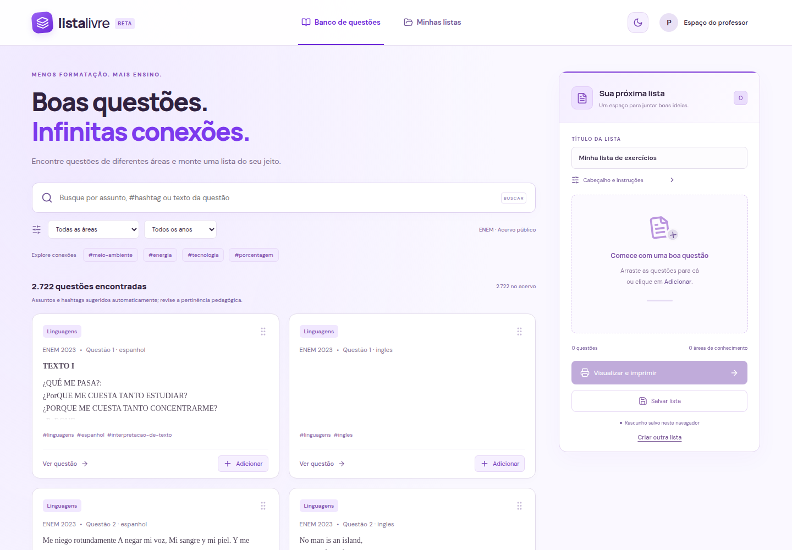

# Lista Livre

**An open-source exercise-list builder for teachers.** Search real Brazilian ENEM exam questions, drag them into a worksheet, reorder, save and print with an optional separate answer key.

[Português](README.md) · [Contributing](CONTRIBUTING.md) · [MIT license](LICENSE)



Light and dark purple themes follow the system preference on first visit. Use the header toggle to save your preferred appearance; printed worksheets stay white.

## Quick start

Requires Node.js **24.x**, npm and internet for the initial data import. No API keys, accounts or external database required.

```sh
git clone https://github.com/gus-aguiar/lista-livre.git
cd lista-livre
npm ci
npm run import
npm run build
npm start
```

Open http://localhost:3000. Importing takes a few minutes. Use `npm run import -- 2023` for a faster, single-year import. This replaces the local question snapshot rather than appending to it.

The initial full import validated 2,722 real questions from 2009–2023 on September 18, 2026. Future imports depend on the upstream catalog. Imported content and personal lists are not committed to this repository.

## Development

```sh
npm run dev              # Vite :5173 + Express :3000
npm test                 # Independent API/search/persistence tests
npm run build
npm run format:check
npx playwright install chromium
npm run test:browser      # Requires imported questions; uses a temporary database
```

The browser test uses `CHROME_PATH`, an installed `/usr/bin/google-chrome`, or Playwright's Chromium. No existing lists are modified. CI runs tests, formatting and build without downloading third-party questions.

## Architecture and scope

React + Vite, Express, Node's built-in SQLite with FTS5. Fonts are bundled locally. See [API documentation](docs/API.md), [data provenance](docs/SOURCES.md), and [contribution guide](CONTRIBUTING.md).

This is a local-first, single-user MVP. There is no authentication or account isolation. By default the server binds to loopback only (`HOST=127.0.0.1`); for a public instance use the demo mode described in [Deploy](#deploy). Question images remain remote. Subject tags are automatic keyword-based suggestions, not official classifications. Review questions before distributing worksheets.

After importing, restart the server to reindex. Preserve the question years referenced by saved lists. Back up `data/` with the server stopped.

## Deploy

The repository ships a container setup for a VPS behind a shared reverse proxy (e.g. Caddy routing `lista.<domain>` to `lista-livre:3000`). The proxy itself is not included.

1. Import the questions locally once (`npm run import`). `data/questions.json` is gitignored but is copied into the image as a seed; on first start it is indexed into the `/data` volume. The build never downloads questions.
2. `cp .env.example .env` and set `DEMO_SECRET` (`openssl rand -hex 32`).
3. `docker network create edge` (once, if the proxy network does not exist yet), then `docker compose up -d --build`.
4. Point the proxy at `lista-livre:3000` on the `edge` network, e.g. `lista.example.com { reverse_proxy lista-livre:3000 }`.

`compose.yaml` publishes no ports, limits memory to 256 MB, restarts `unless-stopped` and keeps data in the `lista-livre-data` volume. To test locally: `docker compose -f compose.yaml -f compose.local.yaml up --build` and open http://127.0.0.1:3000.

| Variable                                       | Default                                       | Purpose                                           |
| ---------------------------------------------- | --------------------------------------------- | ------------------------------------------------- |
| `HOST` / `PORT`                                | `127.0.0.1` / `3000` (`0.0.0.0` in the image) | Listen address                                    |
| `DATA_DIR`                                     | `./data` (`/data` in the image)               | Location of `app.sqlite`                          |
| `QUESTIONS_PATH`                               | `$DATA_DIR/questions.json`                    | Question snapshot to index                        |
| `TRUST_PROXY`                                  | unset                                         | Proxy hops to trust for client IP / HTTPS         |
| `DEMO_MODE`                                    | off                                           | Public demo: lists isolated per anonymous visitor |
| `DEMO_SECRET`                                  | random per start                              | HMAC key for the visitor cookie                   |
| `DEMO_MAX_LISTS`                               | `20`                                          | Lists per visitor                                 |
| `DEMO_RATE_LIMIT` / `DEMO_RATE_WINDOW_SECONDS` | `30` / `60`                                   | Write requests per IP per window                  |
| `DEMO_TTL_HOURS`                               | `72`                                          | Demo lists idle longer than this are deleted      |

In demo mode each visitor receives a signed, HttpOnly cookie with a random id; `/api/lists` only returns and changes that visitor's lists. `GET /api/health` returns `{"status":"ok","questions":<count>,"version":...}` (HTTP 503 if the database is unreachable or empty) and drives the container `HEALTHCHECK`. ### Backup and restore

`npm run backup` (in the container: `docker compose exec lista-livre node server/backup.mjs`) writes a consistent snapshot of `app.sqlite` while the server keeps running (`VACUUM INTO`, WAL included), checks it with `PRAGMA integrity_check`, prints the question and list counts, and keeps the newest `BACKUP_KEEP` files (default 7) in `$DATA_DIR/backups` (`BACKUP_DIR` overrides it). The snapshot lives in the same volume, so copy it off the host too, e.g. a daily cron:

```sh
docker compose exec -T lista-livre node server/backup.mjs \
  && docker compose cp lista-livre:/data/backups ./backups-lista-livre
```

To restore: `docker compose stop`, copy the chosen `app-<timestamp>.sqlite` over `/data/app.sqlite`, delete `/data/app.sqlite-wal` and `/data/app.sqlite-shm` if they exist, then `docker compose start`. A backup is a complete database, so open it with `DATA_DIR` pointing at a scratch copy to test a restore without touching production.

## License

Original application code is **MIT**. Imported exam text and images retain their own provenance and terms; the application license does not relicense them. Data is fetched from the community [ENEM API](https://enem.dev), whose repository declares GPL-2.0. This project is not affiliated with INEP or MEC.
