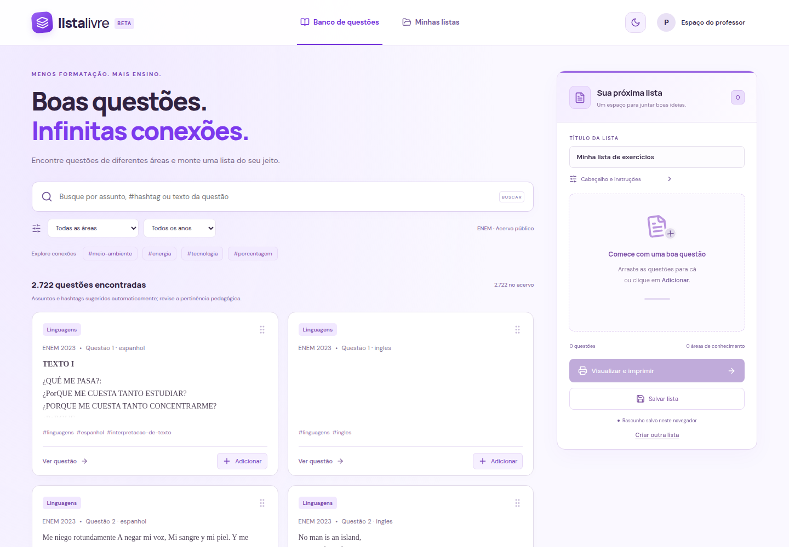

<div align="center">
  
  <h1>Lista Livre</h1>
  <p>Boas questões. Infinitas conexões.</p>
  <p>Um editor open source para professores criarem listas de exercícios com questões reais do ENEM.</p>

[](https://github.com/gus-aguiar/lista-livre/actions/workflows/ci.yml)
[](LICENSE)
[](https://nodejs.org/)

[English](README.en.md) · [Contribuir](CONTRIBUTING.md) · [Reportar problema](https://github.com/gus-aguiar/lista-livre/issues/new/choose)
</div>



## O que você pode fazer

- Buscar no enunciado, nas alternativas e nas hashtags, combinando assuntos entre áreas.
- Filtrar questões por ano e área do conhecimento.
- Alternar entre temas roxo claro e escuro, com preferência salva e detecção do tema do sistema.
- Arrastar questões para uma lista e reordenar; botões também permitem usar teclado ou celular.
- Personalizar título, escola, professor, turma e instruções.
- Salvar listas no SQLite e recuperar o rascunho no navegador.
- Imprimir ou salvar PDF, com gabarito opcional em página separada.

## Começar

Requer **Node.js 24.x**, npm e internet para a importação inicial. Não requer chave de API, conta, Docker ou banco externo.

```sh
git clone https://github.com/gus-aguiar/lista-livre.git
cd lista-livre
npm ci
npm run import
npm run build
npm start
```

Abra **http://localhost:3000**. A importação leva alguns minutos e respeita os limites do provedor. Para experimentar mais rápido, substitua o comando de importação por `npm run import -- 2023`.

O importador cria `data/questions.json` e `data/manifest.json`. O servidor cria e indexa `data/app.sqlite` automaticamente. Arquivos importados e listas pessoais ficam na sua máquina, fora do Git.

> No primeiro acervo completo validado: **2.722 questões**, ENEM **2009–2023**. Esses números são uma referência da coleta de 18/09/2026; novas importações refletem o catálogo disponível na fonte.

## Desenvolvimento

```sh
npm run dev
```

Frontend: http://localhost:5173. Backend: http://localhost:3000. O Vite encaminha `/api` para o backend. Na versão de produção, Express serve tanto a API quanto o frontend compilado.

```sh
npm test                  # Busca, API HTTP e persistência, com dados de teste próprios
npm run build             # Build de produção
npm run format:check      # Formatação
npx playwright install chromium
npm run test:browser      # Fluxo completo; requer questões já importadas
```

O teste de navegador usa um banco temporário e não altera suas listas. Pode usar o Chrome instalado em `/usr/bin/google-chrome`, `CHROME_PATH` ou o Chromium do Playwright. A integração contínua roda testes, build e formatação sem acessar o acervo externo.

## Como funciona

**React + Vite** no frontend; **Express + SQLite FTS5** no backend. Markdown é renderizado sem aceitar HTML bruto. As fontes tipográficas são empacotadas localmente.

| Diretório                 | Responsabilidade                                    |
| ------------------------- | --------------------------------------------------- |
| `src/`                    | Busca, editor de listas, tema e impressão           |
| `server/`                 | API, índice de busca e persistência                 |
| `scripts/import-data.mjs` | Importação reproduzível e tags temáticas por regras |
| `tests/`                  | Integração HTTP, persistência e fluxo no navegador  |
| `docs/`                   | Fontes dos dados e documentação da API              |
| `data/`                   | Arquivos gerados localmente, não publicados         |

Consulte o [contrato da API](docs/API.md) para integrações.

## Dados, qualidade e licença

O **código original deste projeto é MIT**. Você pode usar, modificar e distribuir o software conforme a [licença](LICENSE). Conteúdo importado de terceiros não passa a ser MIT por ser usado pelo aplicativo.

As questões vêm da [ENEM API](https://enem.dev), um projeto comunitário baseado em provas do INEP. O repositório do provedor declara GPL-2.0. [Fontes, atribuição e limites do acervo](docs/SOURCES.md) registram a procedência. O Lista Livre não é afiliado ao INEP ou ao MEC.

As hashtags temáticas são sugestões automáticas por palavras-chave, não classificação pedagógica oficial. Imagens continuam hospedadas na origem e precisam de internet. Conteúdo com problemas conhecidos é sinalizado; confira a questão antes de distribuir. A impressão aguarda as figuras e informa se alguma não carregou.

## Uso local e manutenção

Este MVP é para uso local, **sem autenticação ou separação de contas**. O servidor escuta apenas em `127.0.0.1`. Publicar o código no GitHub não torna as suas listas públicas nem hospeda o aplicativo na internet.

Depois de `npm run import`, reinicie o servidor para reindexar o acervo sem apagar listas. Importar anos específicos **substitui** o snapshot: preserve os anos usados nas listas existentes. Faça backup de `data/` com o servidor parado.

Para transformar em serviço multiusuário, são necessários autenticação, autorização por lista, backup e uma estratégia de armazenamento das imagens.

## Contribuir

Contribuições em código, acessibilidade, documentação e classificação pedagógica são bem-vindas. Veja o [guia de contribuição](CONTRIBUTING.md). Para mudanças grandes, abra uma issue para alinhar a proposta.

Possíveis próximas melhorias: imagens locais, taxonomia revisada por professores, novas fontes de provas e importação/exportação de listas.
